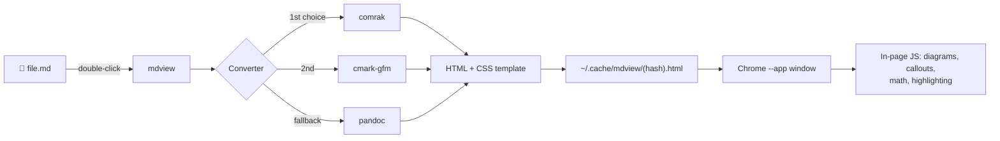

# mdview

**Double-click a Markdown file and read it as a clean, styled page in its own window. No editor, no tabs, no clutter.**

`mdview` converts a `.md` file to HTML with a fast native converter, wraps it in a GitHub-style stylesheet, and opens it in a chromeless Chrome app window. Press <kbd>Esc</kbd> and it's gone.

<!-- Add a screenshot here once you have one:  -->

---

## ✨ Features

- **One double-click.** Registers itself as the default app for `.md` files.
- **Fast.** Conversion takes milliseconds, and the page opens in a lightweight app window.
- **GitHub-style look** that follows your system's light or dark mode.
- **Close with <kbd>Esc</kbd>.**
- **Full GitHub Flavored Markdown:**
  - Tables, task lists, footnotes, strikethrough and autolinks
  - Syntax-highlighted code blocks (highlight.js)
  - **Mermaid diagrams**: flowcharts, sequence, state, timeline, charts and more
  - GitHub-style callouts: `> [!NOTE]`, `[!TIP]`, `[!IMPORTANT]`, `[!WARNING]`, `[!CAUTION]`
  - Math with `$inline$` and `$$display$$` (KaTeX)
  - Raw HTML: `<details>`, `<kbd>`, `<mark>`, `<sub>`, `<sup>`
- **Relative images and links just work.** Pages resolve paths from the Markdown file's own folder.
- **Linkable headings.** Hover any heading to get a `#` link.
- **Loads only what a page needs.** Diagram and math libraries load only when a file uses them.
- **Works offline.** The installer keeps local copies of the diagram and highlighting libraries.
- **No framework.** About 50 lines of plain CSS, easy to restyle.

## 📦 Requirements

| Requirement | Notes |
| :--- | :--- |
| Linux desktop | Tested on Fedora KDE. Any freedesktop.org desktop (KDE, GNOME, …) should work |
| A Chromium browser | Google Chrome, Chromium, Brave or Edge. Flatpak Chrome is supported |
| A Markdown converter | One of `comrak`, `cmark-gfm` or `pandoc`. The installer adds one for you |
| `python3`, `curl` | Present on most distros |

## 🚀 Install

```bash
git clone https://github.com/<your-username>/mdview.git
cd mdview
chmod +x install-mdview.sh
./install-mdview.sh
```

The installer will:

1. Install `cmark-gfm`, or fall back to `pandoc`, via `dnf`.
2. Copy `mdview` to `~/.local/bin/`.
3. Download local copies of Mermaid and highlight.js to `~/.local/share/mdview/vendor/`.
4. Create a desktop entry and make it the default app for `text/markdown`.

> [!TIP]
> On a non-Fedora distro, install `pandoc` or `cmark-gfm` with your package manager first. The `dnf` step will fail harmlessly.

## 🖱️ Usage

**Double-click** any `.md` file in your file manager, or run it from a terminal:

```bash
mdview README.md
```

| Key / action | Result |
| :--- | :--- |
| <kbd>Esc</kbd> | Close the window |
| <kbd>Ctrl</kbd> + <kbd>F</kbd> | Search the page |
| <kbd>Ctrl</kbd> + <kbd>P</kbd> | Print or save as PDF |
| Click a table-of-contents link | Smooth-scroll to that section |
| Click an external link | Opens in your normal browser |

Try the included sample to see every feature at once:

```bash
mdview examples/dolphins.md
```

## ⚙️ How it works



1. **Convert.** The fastest converter on your system turns the Markdown into HTML.
2. **Wrap.** The HTML goes into a template with inline CSS and a `<base>` tag pointing at the file's folder, so relative paths work.
3. **Cache.** The page is written to `~/.cache/mdview/`, named by a hash of the file's path, so each file reuses one cache entry.
4. **Open.** Chrome opens the page with `--app=`, which gives a standalone window with no tabs or address bar.
5. **Enhance.** A small script adds heading anchors and callouts, renders Mermaid and math, and highlights code. Each step is isolated, so one failure never breaks the others.

## 🎨 Customizing

All styling lives in the `<style>` block inside `mdview`. Colours are CSS variables at the top:

```css
:root {
  --bg: #fff; --fg: #1f2328; --muted: #59636e;
  --border: #d1d9e0; --soft: #f6f8fa; --link: #0969da;
}
```

Dark mode overrides the same variables inside `@media (prefers-color-scheme: dark)`. Edit `~/.local/bin/mdview` directly, or edit the repo copy and re-run the installer.

**Faster conversion:** install [comrak](https://github.com/kivikakk/comrak) (`cargo install comrak`) and `mdview` will use it automatically.

## 🩺 Troubleshooting

<details>
<summary>Double-clicking still opens a text editor</summary>

Check which app is registered:

```bash
xdg-mime query default text/markdown   # should print mdview.desktop
```

In KDE you can also right-click a `.md` file → **Properties → File Type Options** and move *Markdown Viewer* to the top.

</details>

<details>
<summary>Diagrams show up as code</summary>

1. Make sure you re-ran the installer after updating, so `~/.local/bin/mdview` is the latest version.
2. Open the window's DevTools with <kbd>Ctrl</kbd> + <kbd>Shift</kbd> + <kbd>J</kbd>. `mdview` logs which step failed.
3. Check that `~/.local/share/mdview/vendor/mermaid.min.js` exists. If it doesn't, the page needs internet access to load Mermaid from a CDN.

</details>

<details>
<summary><kbd>Esc</kbd> doesn't close the window</summary>

Chrome only lets a page close itself when it was opened as a fresh window. If you navigated to another page inside the window, close it normally with <kbd>Ctrl</kbd> + <kbd>W</kbd>.

</details>

## 🗺️ Roadmap

### Next up
- [ ] **Cross-platform core.** Render Markdown in the page with markdown-it, so no native converter is needed and the launcher shrinks to a few lines
- [ ] **macOS support.** `.app` wrapper and "Open With → Change All" setup
- [ ] **Windows support.** PowerShell or `.cmd` launcher plus file association
- [ ] **Live reload.** The window refreshes when the file is saved

### Reading experience
- [ ] Floating table of contents, generated from headings
- [ ] Reading-progress bar and estimated reading time
- [ ] Theme switcher (GitHub, Sepia, Solarized) remembered between sessions
- [ ] Adjustable font size and content width
- [ ] Image lightbox (click to zoom)
- [ ] Copy button on code blocks

### Power features
- [ ] Follow links to other `.md` files inside the same window
- [ ] Front-matter support (title and metadata header)
- [ ] Wiki-style `[[links]]`
- [ ] One-click export to a standalone HTML or PDF file
- [ ] Bundle KaTeX locally for full offline math

### Packaging
- [ ] Uninstall script
- [ ] Packages for Fedora (COPR) and Arch (AUR)
- [ ] Homebrew formula for macOS

Have an idea? [Open an issue](../../issues).

## 📁 Project structure

```
mdview/
├── mdview                # the viewer script
├── install-mdview.sh     # installer and file association
├── examples/
│   └── dolphins.md       # sample showing every supported feature
└── README.md
```

## 🙏 Built with

- [pandoc](https://pandoc.org), [cmark-gfm](https://github.com/github/cmark-gfm) and [comrak](https://github.com/kivikakk/comrak): Markdown conversion
- [Mermaid](https://mermaid.js.org): diagrams
- [highlight.js](https://highlightjs.org): syntax highlighting
- [KaTeX](https://katex.org): math rendering

## 📄 License

MIT. See [`LICENSE`](LICENSE).
