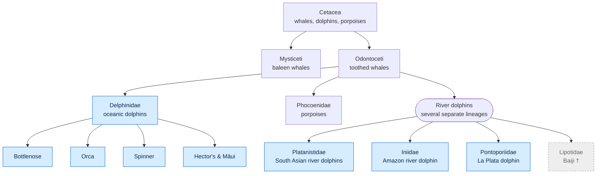
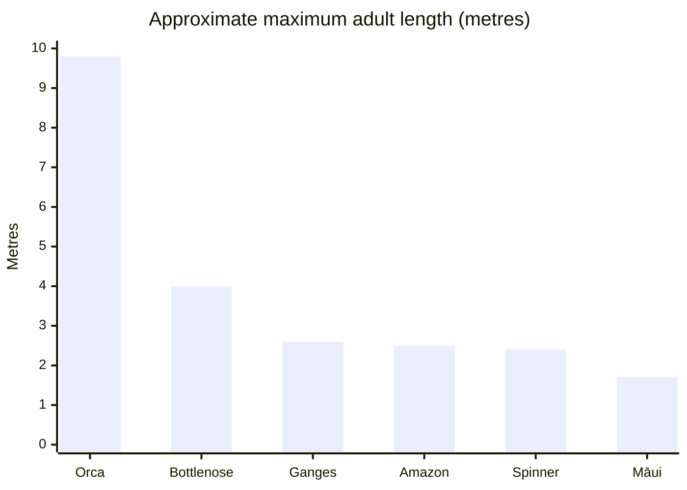
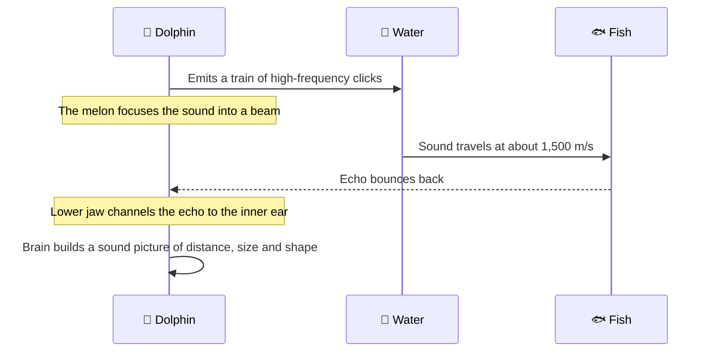
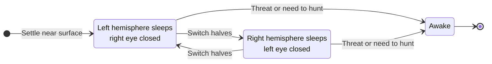
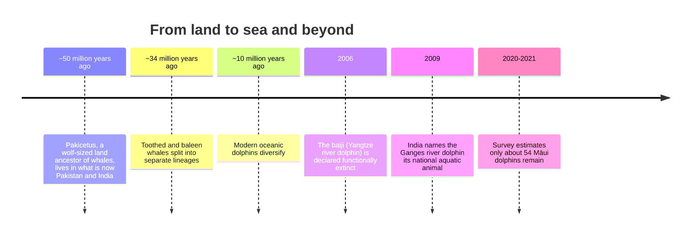

# 🐬 Dolphins: The Ocean's Brightest Minds


*A bottlenose dolphin with her calf. Photo: Wikimedia Commons.*

Dolphins are **toothed whales**: warm-blooded, air-breathing mammals that are fully adapted to life in water. They are known for complex social lives, ~~simple~~ *surprisingly sophisticated* communication, and the ability to **see with sound**.

> [!NOTE]
> "Dolphin" is a common name, not one scientific group. Most species belong to the oceanic dolphin family, *Delphinidae*. The river dolphins come from several separate, older lineages.

---

## 📑 Table of Contents

1. [Quick Facts](#-quick-facts)
2. [Where Dolphins Sit on the Family Tree](#-where-dolphins-sit-on-the-family-tree)
3. [Meet the Species](#-meet-the-species)
4. [Seeing With Sound: Echolocation](#-seeing-with-sound-echolocation)
5. [How Dolphins Sleep](#-how-dolphins-sleep)
6. [India's Own Dolphin](#-indias-own-dolphin)
7. [A Brief History](#-a-brief-history)
8. [Threats & Conservation](#-threats--conservation)
9. [Myths vs. Facts](#-myths-vs-facts)
10. [How You Can Help](#-how-you-can-help)

---

## 📊 Quick Facts

| Feature            | Common Bottlenose Dolphin                        |
| :----------------- | :----------------------------------------------- |
| Scientific name    | *Tursiops truncatus*                             |
| Length             | 2–4 m (6.6–13 ft)                                |
| Weight             | 150–650 kg                                       |
| Lifespan (wild)    | 40–60 years; females usually live longer[^bottlenose] |
| Global population  | ~600,000                                         |
| IUCN status        | 🟢 Least Concern                                  |
| Superpower         | Echolocation and individual "signature whistles" |

> [!TIP]
> Each bottlenose dolphin develops its own **signature whistle**, which works much like a name. Others can call out to a specific individual by copying it.

---

## 🌳 Where Dolphins Sit on the Family Tree



Yes, the **orca (killer whale) is a dolphin**. It is the largest member of the oceanic dolphin family.

---

## 🐋 Meet the Species

|  | Species | Lives in | Max length | IUCN status |
| :---: | :--- | :--- | ---: | :--- |
| .jpg?width=240) | **Common bottlenose** | Warm & temperate oceans worldwide | ~4 m | 🟢 Least Concern |
| .jpg?width=240) | **Orca** | Every ocean, polar to tropical | ~9.8 m | ⚪ Data Deficient |
|  | **Spinner** | Tropical oceans | ~2.4 m | 🟢 Least Concern |
|  | **Amazon river (boto)** | Amazon & Orinoco basins | ~2.5 m | 🟠 Endangered |
| — | **Ganges river** | Ganges–Brahmaputra–Meghna rivers | ~2.6 m | 🟠 Endangered |
| — | **Māui** | West coast of New Zealand's North Island | ~1.7 m | 🔴 Critically Endangered |



<details>
<summary>🩷 Why are Amazon river dolphins pink?</summary>

Adult males are often strikingly pink. The colour is thought to come mostly from **scar tissue** built up during rough play and fights. That is why males, which fight more, tend to be pinker than females.

</details>

---

## 🔊 Seeing With Sound: Echolocation

Dolphins produce rapid **clicks** in their nasal passages, focus them through the fatty **melon** on their forehead, and listen for the echoes. Fat-filled channels in the lower jaw carry the returning sound to the inner ear.



### The math behind it

The sound travels **to** the target and **back**, so the distance is half the total path:

$$
d = \frac{v \cdot t}{2}
$$

where $v \approx 1500\ \text{m/s}$ is the speed of sound in seawater and $t$ is the round-trip time.

**Example:** an echo that returns after $t = 0.2\ \text{s}$ means the fish is $d = \frac{1500 \times 0.2}{2} = 150\ \text{m}$ away.

```python
SPEED_OF_SOUND_SEAWATER = 1500  # m/s (varies with temperature, salinity, depth)

def echo_distance(round_trip_seconds: float) -> float:
    """Distance to a target from an echolocation round-trip time."""
    return SPEED_OF_SOUND_SEAWATER * round_trip_seconds / 2

for t in (0.01, 0.05, 0.2):
    print(f"Echo after {t:>5}s  →  target at {echo_distance(t):6.1f} m")
```

---

## 😴 How Dolphins Sleep

Dolphins are **conscious breathers**: every breath is a deliberate choice. They can't fully switch off, so they use **unihemispheric slow-wave sleep**, resting **one half of the brain at a time**.



While one half rests, the other keeps the dolphin surfacing to breathe and watching for predators, with the **opposite eye** open.

---

## 🇮🇳 India's Own Dolphin


The **Ganges river dolphin** (*Platanista gangetica*), locally called *susu*, is **India's national aquatic animal**.

- 👁️ **Nearly blind**: its tiny eyes have **no lens**, so in muddy river water it relies almost entirely on echolocation[^southasian].
- 🧭 **Swims on its side**, trailing a flipper along the riverbed to feel its way.
- 🏞️ **Range**: the Ganges, Brahmaputra and Meghna river systems across India, Nepal and Bangladesh.
- 📈 **Good news**: a 2021–23 survey counted **over 6,000** Ganges river dolphins in India.

> [!IMPORTANT]
> Ganges river dolphins live in some of the most densely populated river basins on Earth. Dams, pollution, sand mining and fishing nets are the main threats they face.

---

## 🕰️ A Brief History



---

## ⚠️ Threats & Conservation

> [!CAUTION]
> The **Māui dolphin** is one of the rarest dolphins in the world. The latest survey estimated just **54 individuals** older than one year, with a 95% confidence interval of **48–66**[^maui].

### Main threats

1. **Bycatch**: entanglement in fishing nets is the biggest killer for many species
   - Gillnets and trawl nets are especially dangerous
   - Dolphins drown because they cannot reach the surface to breathe
2. **Habitat loss**: dams split river dolphin populations and block their movement
3. **Pollution**: plastics, chemical runoff and heavy metals build up in their bodies
4. **Noise**: shipping and seismic surveys interfere with echolocation
5. **Disease**: some populations face toxoplasmosis and other infections

> [!WARNING]
> The **baiji** shows how fast a species can disappear. Once found throughout the Yangtze River, it was declared functionally extinct in 2006, mainly because of fishing and river traffic.

---

## 🧠 Myths vs. Facts

| Myth | Reality |
| :--- | :--- |
| Dolphins are fish | ❌ They're **mammals**: they breathe air, are warm-blooded and nurse their young |
| Orcas are whales, not dolphins | ❌ Orcas are the **largest dolphins** |
| Dolphins sleep like we do | ❌ They rest **one brain hemisphere at a time** |
| All dolphins live in the sea | ❌ Several species live only in **rivers** |
| A dolphin's smile means it's happy | ❌ That "smile" is just the **fixed shape** of its jaw |

<details>
<summary>💬 Do dolphins really have names?</summary>

In a sense, yes. Bottlenose dolphins develop **signature whistles** early in life and keep them for decades. Studies show that dolphins respond when another dolphin copies their whistle, much like we turn around when someone says our name.

</details>

---

## ✅ How You Can Help

- [x] Learn about dolphins (you're doing it right now! 🎉)
- [ ] Choose seafood certified as **dolphin-safe** or from sustainable fisheries
- [ ] Cut down on single-use plastics, which end up in rivers and oceans
- [ ] Watch dolphins only through **responsible, licensed** tour operators
- [ ] Never feed or chase wild dolphins
- [ ] Support conservation groups working on river dolphin protection
- [ ] Share what you've learned 🐬

---

## ⌨️ Viewer Tips

Press <kbd>Ctrl</kbd> + <kbd>F</kbd> to search this page, or <kbd>Ctrl</kbd> + <kbd>P</kbd> to print it. Hover over any heading to get a link to that section. <mark>Highlighted text</mark> works too, along with H<sub>2</sub>O and 10<sup>6</sup>.

---

### Sources & Credits

All images are from [Wikimedia Commons](https://commons.wikimedia.org) and are used under their respective free licences.

[^bottlenose]: [Common bottlenose dolphin — Wikipedia](https://en.wikipedia.org/wiki/Common_bottlenose_dolphin)
[^southasian]: [South Asian river dolphin — Wikipedia](https://en.wikipedia.org/wiki/South_Asian_river_dolphin)
[^maui]: [Māui dolphin abundance estimate — NZ Department of Conservation](https://www.doc.govt.nz/our-work/protecting-species/protecting-marine-species/our-work-with-maui-dolphin/maui-dolphin-abundance-estimate/)
